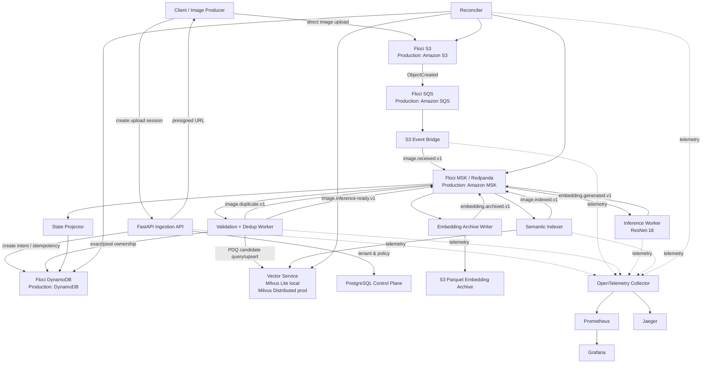
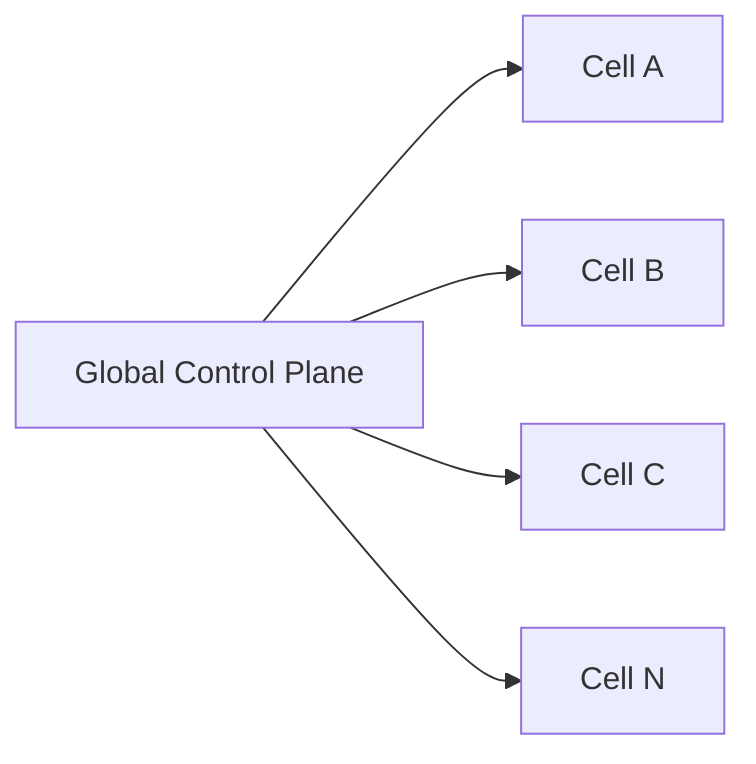

# Architecture

## 1. Problem statement

The platform receives images continuously and must transform each accepted image into a durable, searchable visual embedding. It must also prevent expensive duplicate work, reject corrupt inputs, tolerate repeated events, survive service outages, expose processing status, and provide enough observability to explain what happened to any individual image.

Initial traffic is approximately 10 million images/day. Future requirements indicate 500 million to 1 billion images/day. Average image size is approximately 2 MB, with individual images ranging from roughly 100 KB to 20 MB.

The important architectural insight is that this is not only a computer-vision problem. It is simultaneously:

- a large-object ingestion problem,
- a durable streaming problem,
- a high-throughput state-management problem,
- a copy-detection problem,
- a model-inference problem,
- a vector-index problem,
- a failure-recovery problem,
- and an observability problem.

## 2. Scale translation

At 10M/day:

```text
10,000,000 / 86,400 ≈ 116 images/sec average
116 × 2 MB ≈ 232 MB/sec average object ingress
≈ 20 TB/day raw image data
```

At 500M/day:

```text
≈ 5,787 images/sec
≈ 11.6 GB/sec at 2 MB average
≈ 1 PB/day
```

At 1B/day:

```text
≈ 11,574 images/sec
≈ 23 GB/sec at 2 MB average
≈ 2 PB/day
```

These are average rates. Capacity planning must include burst rate, retries, backlog recovery, deployment headroom, and failed-node capacity.

## 3. Architectural principles

1. Object storage owns image bytes.
2. Kafka owns replayable processing events, not blobs.
3. Heavy work is asynchronous.
4. Every externally visible side effect is idempotent.
5. Exact ownership operations use atomic conditional writes.
6. Duplicate decisions are reversible logical relationships.
7. Search/index infrastructure is rebuildable derived state.
8. Expensive embeddings are durably archived before we consider the pipeline fully durable.
9. CPU-heavy validation/dedup, model inference, archival, and indexing scale independently.
10. Local deployment preserves production semantics even when capacity is tiny.

## 4. End-to-end component diagram



## 5. Why direct-to-S3 upload

The API should not proxy the normal image payload. At initial scale the raw traffic is already around 20 TB/day. A proxy design would force application servers to receive every byte and send every byte again to object storage. That duplicates network work and turns the API tier into a data-transfer bottleneck.

Instead:

```text
Client -> tiny control request -> API
Client -> large object bytes -> S3
```

The API remains responsible for identity, authorization, idempotency, policy, and upload-session creation.

## 6. Why SQS and Kafka both exist

They have different jobs.

SQS is the durable edge buffer for object-created notifications. S3 integrates naturally with SQS. If the Kafka bridge is temporarily unavailable, SQS can retain pending object notifications.

Kafka is the durable processing log. It exists because we need consumer groups, replay, independent downstream consumers, long backlogs, model reprocessing, and stage decoupling.

The bridge follows this rule:

```text
read SQS -> publish Kafka -> wait for Kafka acknowledgement -> delete SQS message
```

If it crashes after Kafka publish but before SQS delete, the notification can be republished. That is expected; downstream consumers are idempotent.

## 7. Kafka topic model

Start with domain-level topics:

```text
image.received.v1
image.duplicate.v1
image.inference-ready.v1
embedding.generated.v1
embedding.archived.v1
image.indexed.v1
processing.failed.v1
```

Key each image-lifecycle message by `image_id` so events for the same image consistently map to the same partition. We do not require global ordering across unrelated images.

Local development can use a small partition count, for example 6–8, simply to exercise parallelism. Production partition count is determined by throughput benchmarks and desired consumer parallelism. Do not hard-code a universal production number.

## 8. Concurrency model

There is no single "system concurrency" value. Each stage has a different bottleneck.

### 8.1 API concurrency

Mostly I/O-bound. One local Uvicorn worker is enough. Production scales stateless API replicas horizontally.

### 8.2 Object fetch concurrency

S3 reads are I/O-heavy. The processing worker may have several objects in flight while keeping CPU-heavy verification bounded.

Suggested local starting values:

```env
PROCESSOR_MAX_INFLIGHT_IMAGES=4
S3_FETCH_CONCURRENCY=8
ORB_VERIFY_CONCURRENCY=2
```

These are starting values for a 16 GB laptop, not architectural constants.

### 8.3 CPU image concurrency

Decode, PDQ, ORB, RANSAC, and SSIM are CPU-heavy. Unbounded async tasks will only create contention. Use bounded work queues/semaphores and scale processes/containers rather than spawning hundreds of CPU tasks.

### 8.4 Inference concurrency

Local canonical mode uses one CPU inference worker and micro-batching. Suggested start:

```env
INFERENCE_WORKERS=1
INFERENCE_MAX_BATCH=8
INFERENCE_MAX_WAIT_MS=25
```

Measure memory/latency and adjust.

### 8.5 Kafka concurrency

Within one consumer group, maximum simultaneously assigned partition consumers is bounded by topic partition count. Production worker count and partitions should be capacity-planned together.

### 8.6 Candidate fan-out

PDQ candidate search must be bounded. Never allow one image to generate unbounded ORB work.

```env
PDQ_TOP_K=20
MAX_ORB_CANDIDATES=10
```

These are initial test values. Final values come from recall/precision evaluation.

## 9. Capacity formula

A useful recovery-planning formula is:

```text
required_processing_rate
=
current_arrival_rate
+
backlog_size / desired_recovery_window
```

If we receive 116 images/sec and build a six-hour backlog of roughly 2.5M images, clearing it in another six hours while new traffic continues requires roughly 232 images/sec capacity.

This is why autoscaling should consider:

- input rate,
- consumer lag,
- age of oldest unprocessed event,
- actual service throughput,
- target recovery time,
- CPU/GPU utilization,
- batch occupancy.

## 10. State ownership

### S3

Owns immutable source image bytes and long-lived embedding Parquet files.

### DynamoDB

Owns hot key/value processing state, request idempotency, exact-hash ownership, pixel-hash ownership, and duplicate-group state.

### PostgreSQL

Owns relational control-plane information: tenants, users, model definitions, policy versions, RBAC, datasets, administrative configuration.

### Kafka

Owns event history for the operational retention window. Kafka is not the permanent archive.

### Milvus-compatible vector service

Owns rebuildable similarity indexes: PDQ binary Hamming search and CNN float-vector cosine search.

## 11. Why Milvus Lite locally

A full Milvus Standalone deployment has meaningful memory requirements; its documented minimum is around 8 GB and recommended standalone RAM is higher. Running that plus Floci, Redpanda, PostgreSQL, observability, OpenCV workers, and the model on a 16 GB laptop would waste local resources.

Milvus Lite is specifically designed for laptops and Apple Silicon, uses the same client API family, and can later migrate to Standalone/Distributed.

Therefore local architecture uses a dedicated `vector-service` process that owns the Milvus Lite database file. Other services do not open the same file directly. They call the vector-service API. In production the vector-service switches configuration from a file URI to a distributed Milvus endpoint.

That preserves the **application contract** while scaling the engine.

## 12. Local-to-production mapping

| Local | Production |
|---|---|
| Floci S3 | Amazon S3 |
| Floci SQS | Amazon SQS |
| Floci MSK/Redpanda | Amazon MSK |
| Floci DynamoDB | Amazon DynamoDB |
| Floci RDS PostgreSQL | RDS/Aurora PostgreSQL |
| Milvus Lite | Milvus Standalone/Distributed |
| one processor | processor autoscaling pool |
| one CPU inference worker | GPU/CPU inference pool |
| Docker Compose | Kubernetes/ECS-class orchestrator |
| Jaeger | Jaeger/Tempo/vendor backend |
| local Prometheus | managed/cluster Prometheus |

## 13. Failure behavior

### API down

New upload-session creation pauses. Existing S3/Kafka processing continues.

### Event bridge down

SQS backlog grows. No accepted object is lost.

### Kafka down

SQS remains an edge buffer; services retry/backpressure.

### Processor down

Kafka `image.received` lag grows. On restart the consumer resumes.

### PDQ vector service down

Near-copy detection should fail **open** for data integrity: do not declare a fuzzy duplicate. Either retry briefly or mark the perceptual check deferred and process as unique according to configured policy. Exact SHA/pixel identity can still operate if DynamoDB is healthy.

### Inference down

`image.inference-ready` backlog grows. Upload/dedup continues.

### Semantic vector index down

Inference and embedding archival continue. Indexer lag grows.

### State projector down

Processing continues; status API may be stale until the projector catches up.

### Entire semantic index lost

Rebuild from S3/Parquet embedding archive. Do not rerun every image through the model.

## 14. Cell-based future scaling

At 500M–1B images/day, do not create one infinitely large global processing cluster. Introduce cells.



A cell owns a bounded shard of tenants/regions/datasets and contains its own processing stream and compute pools. This limits blast radius and gives a clear capacity unit. The local laptop is effectively `Cell 0` with one instance of each service.

## 15. Scaling rule

**Scale capacity, not semantics.**

The junior implementation should never introduce a local-only shortcut that changes correctness rules. If a production service is too expensive to run locally, use a lighter deployment mode behind the same interface, as with Milvus Lite.

## References

- Floci services: https://floci.io/floci/services/
- Floci MSK uses Redpanda: https://floci.io/floci/configuration/environment-variables/
- Milvus Lite: https://milvus.io/docs/milvus_lite.md
- Milvus deployment options: https://milvus.io/docs/install-overview.md
