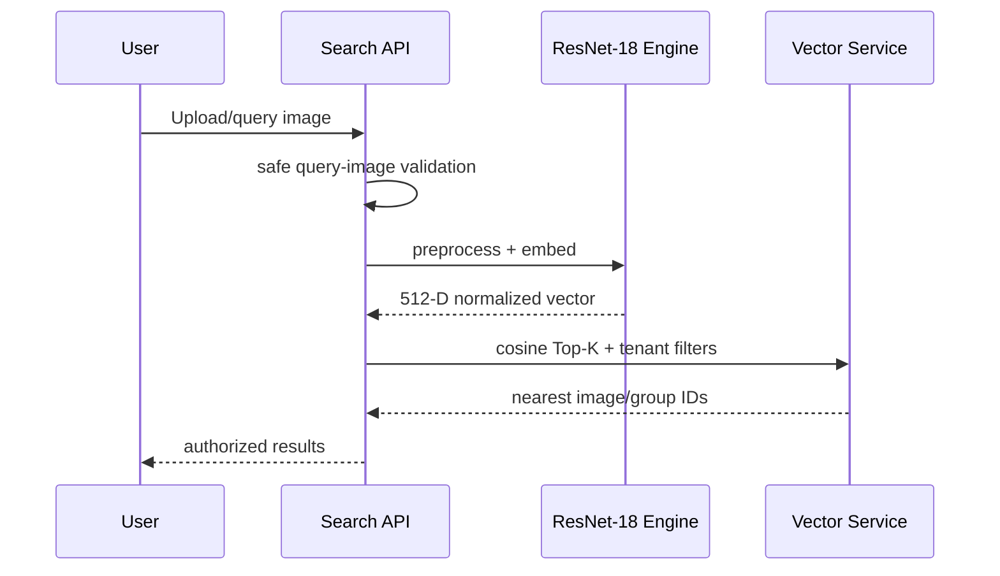

# Embeddings and Vector Search

## 1. Scope

The first model is deliberately **not transformer-based**. We use a lightweight pretrained CNN so the complete pipeline remains practical on the local M1 Pro machine and inside Docker CPU execution.

The initial retrieval capability is **image-to-image visual similarity**.

Text-to-image search is out of scope for the initial model because ordinary ResNet-18 does not provide a joint text/image embedding space. The architecture keeps the model replaceable so a multimodal model can be introduced later if product requirements change.

## 2. Model choice — pretrained ResNet-18

Use torchvision:

```python
from torchvision.models import resnet18, ResNet18_Weights
import torch.nn as nn

weights = ResNet18_Weights.DEFAULT
model = resnet18(weights=weights)
model.fc = nn.Identity()
model.eval()
```

With the classifier replaced by `Identity`, ResNet-18 returns the 512-dimensional feature after global average pooling.

The current torchvision documentation lists approximately:

```text
11.7M parameters
~44.7 MB pretrained weights
1.81 GFLOPs
```

This is a good local baseline because it is small, well-understood, and CPU-friendly compared with modern transformer encoders.

## 3. Preprocessing

Use the preprocessing associated with the selected pretrained weights rather than writing a slightly different manual transform.

```python
preprocess = weights.transforms()
```

The current default ImageNet transform includes resize/crop and ImageNet normalization. Record this as a versioned preprocessing contract.

Example:

```text
model_name = resnet18
model_version = torchvision-imagenet1k-v1
preprocess_version = resnet18-default-v1
embedding_dim = 512
```

## 4. Feature normalization

L2 normalize output before cosine search:

```python
features = model(batch)
features = torch.nn.functional.normalize(features, p=2, dim=1)
```

With normalized vectors, cosine similarity has a clear interpretation and stable retrieval behavior.

## 5. Embedding interface

Do not let application code directly depend on ResNet-specific internals.

```python
class EmbeddingEngine(Protocol):
    @property
    def model_version(self) -> str: ...

    @property
    def preprocessing_version(self) -> str: ...

    @property
    def dimension(self) -> int: ...

    def embed_images(self, images: list[Image.Image]) -> np.ndarray: ...
```

Initial implementation:

```text
TorchvisionResNet18EmbeddingEngine
```

Future implementations can include:

```text
EfficientNetEmbeddingEngine
MobileNetEmbeddingEngine
ConvNeXtEmbeddingEngine
DomainSpecificCNNEmbeddingEngine
MultimodalEmbeddingEngine
```

without changing S3/Kafka/DynamoDB pipeline semantics.

## 6. Local compute

Canonical local deployment runs inference in Docker on CPU for reproducibility.

Suggested starting configuration:

```env
EMBEDDING_MODEL=resnet18
EMBEDDING_DEVICE=cpu
INFERENCE_WORKERS=1
INFERENCE_MAX_BATCH=8
INFERENCE_MAX_WAIT_MS=25
```

Benchmark and adjust batch size based on actual latency and memory.

The M1 Pro supports PyTorch MPS in a host-native environment, but the all-Docker reference deployment should not depend on macOS Metal availability inside Linux containers. If a developer wants a host-native speed experiment, the same engine may use `device=mps`, but that is an optional developer mode rather than the canonical deployment path.

## 7. Dynamic micro-batching

Continuous ingestion does not imply batch size one.

Worker behavior:

```text
receive events continuously
        ↓
collect until either
- batch reaches MAX_BATCH_SIZE, or
- MAX_WAIT_MS expires
        ↓
run one model call
```

This improves compute efficiency while preserving streaming semantics.

## 8. Embedding identity

An embedding must be uniquely determined by:

```text
representative image / image group
model version
preprocessing version
```

Use a deterministic ID:

```python
embedding_id = sha256(
    f"{duplicate_group_id}|{model_version}|{preprocess_version}".encode()
).hexdigest()
```

If an image is not in a duplicate group yet, use a stable image identity according to the data model.

## 9. Event

`embedding.generated.v1` contains at least:

```text
event_id
image_id
duplicate_group_id
embedding_id
model_name
model_version
preprocessing_version
dimension
created_at
trace context
```

The vector payload may be included directly because 512 float32 values are only ~2 KB, but the event schema should be designed so large future outputs can be referenced indirectly if necessary.

## 10. Durable archive

The vector database is not the only durable copy of embeddings.

Archive writer buffers generated embedding records and writes Parquet files to S3:

```text
embedding-archive/
  model=resnet18/
    model_version=.../
      date=2026-09-30/
        part-000001.parquet
```

Suggested columns:

```text
embedding_id
image_id
duplicate_group_id
tenant_id
model_version
preprocessing_version
vector
created_at
```

Why archive:

- rebuilding Milvus does not require re-running CNN inference,
- model migration can compare old/new vectors,
- offline evaluation becomes easier,
- expensive compute output survives search-index failures.

## 11. Vector service

A dedicated service owns local Milvus Lite storage. Other services call this service instead of opening the same local database file concurrently.

Internal endpoints can include:

```text
POST /internal/v1/pdq/search
POST /internal/v1/pdq/upsert
POST /internal/v1/embeddings/upsert
POST /internal/v1/embeddings/search
DELETE /internal/v1/embeddings/{id}
GET  /healthz
```

Local implementation:

```python
MilvusClient("/data/milvus.db")
```

Production implementation:

```python
MilvusClient(uri="http://milvus-cluster:19530", token="...")
```

The service contract remains stable.

## 12. Collections

### 12.1 PDQ collection

```text
name: dedup_pdq_v1
vector: BINARY_VECTOR, 256 bits
metric: HAMMING
```

Metadata:

```text
image_id
duplicate_group_id
dedup_scope_id
object_key
pdq_quality
width
height
```

### 12.2 CNN embedding collection

```text
name: visual_resnet18_v1
vector: FLOAT_VECTOR, dimension 512
metric: COSINE
```

Metadata:

```text
embedding_id
image_id
duplicate_group_id
tenant_id
dataset_id
model_version
preprocess_version
created_at
```

## 13. Image-to-image search



The query image uses the **same model and preprocessing version** as the collection being searched.

## 14. Model migration

Never overwrite incompatible vectors in place.

Example:

```text
visual_resnet18_v1
visual_efficientnet_v2
```

Migration procedure:

1. Define new model/preprocessing version.
2. Create new vector collection.
3. Backfill unique/canonical images from source or archived artifacts.
4. Evaluate retrieval metrics.
5. Switch logical search alias/configuration.
6. Keep old collection during rollback window.
7. Remove later according to retention policy.

## 15. Retrieval evaluation

For CNN visual retrieval measure at least:

```text
Recall@1
Recall@5
Recall@10
Precision@K or category agreement
latency p50/p95/p99
index size
```

COCO val2017 can serve as a manageable general image corpus. Because the initial model is not multimodal, use image-query retrieval and available object/category annotations for sanity/evaluation rather than caption-to-image search.

## 16. Why not a transformer now

This is a resource and requirement decision, not an architectural limitation.

We currently prioritize:

- local CPU feasibility,
- simple stable dependency chain,
- visual image-to-image retrieval,
- model replaceability.

If the client later requires better domain semantics or text queries, benchmark replacements behind the same `EmbeddingEngine` interface.

## References

- torchvision ResNet-18: https://docs.pytorch.org/vision/stable/models/generated/torchvision.models.resnet18.html
- PyTorch MPS: https://docs.pytorch.org/docs/stable/notes/mps.html
- Milvus Lite: https://milvus.io/docs/milvus_lite.md
