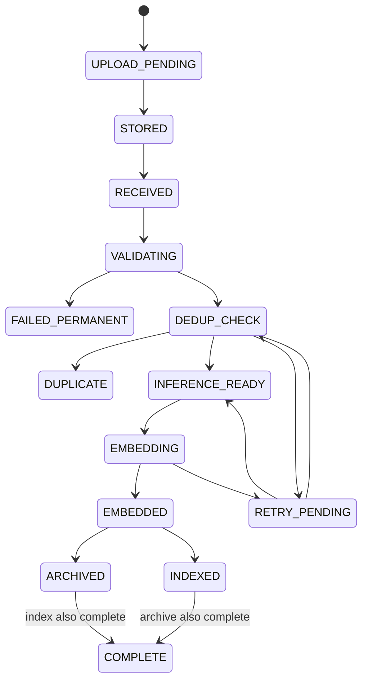

# Software Design Specification (SDS)

## 1. Repository structure

```text
image-platform/
├── docker-compose.yml
├── .env.example
├── pyproject.toml
├── README.md
│
├── proto/
│   ├── image_received_v1.proto
│   ├── image_duplicate_v1.proto
│   ├── image_inference_ready_v1.proto
│   ├── embedding_generated_v1.proto
│   ├── embedding_archived_v1.proto
│   ├── image_indexed_v1.proto
│   └── processing_failed_v1.proto
│
├── src/
│   ├── common/
│   │   ├── config.py
│   │   ├── ids.py
│   │   ├── errors.py
│   │   ├── logging.py
│   │   └── telemetry.py
│   ├── domain/
│   │   ├── image.py
│   │   ├── duplicate.py
│   │   ├── embedding.py
│   │   ├── events.py
│   │   └── state.py
│   ├── adapters/
│   │   ├── s3.py
│   │   ├── sqs.py
│   │   ├── kafka.py
│   │   ├── dynamodb.py
│   │   ├── postgres.py
│   │   └── vector_service.py
│   ├── dedup/
│   │   ├── sha256.py
│   │   ├── canonical_pixels.py
│   │   ├── pdq.py
│   │   ├── orb.py
│   │   ├── geometry.py
│   │   ├── ssim.py
│   │   └── policy.py
│   ├── inference/
│   │   ├── interface.py
│   │   ├── resnet18.py
│   │   ├── batching.py
│   │   └── preprocessing.py
│   ├── archive/
│   │   └── parquet.py
│   └── reconciliation/
│       └── service.py
│
├── services/
│   ├── api/main.py
│   ├── event_bridge/main.py
│   ├── processor/main.py
│   ├── inference_worker/main.py
│   ├── vector_service/main.py
│   ├── archive_writer/main.py
│   ├── semantic_indexer/main.py
│   ├── state_projector/main.py
│   └── reconciler/main.py
│
├── datasets/
│   ├── prepare_copydays.py
│   ├── prepare_coco.py
│   ├── generate_variants.py
│   └── manifest.schema.json
│
├── tests/
│   ├── unit/
│   ├── contract/
│   ├── integration/
│   ├── concurrency/
│   ├── chaos/
│   └── e2e/
│
└── infrastructure/
    ├── prometheus/
    ├── grafana/
    └── otel/
```

## 2. Service boundaries

### 2.1 `ingestion-api`

Responsibilities:

- authentication/authorization stub locally,
- request idempotency,
- create `image_id`,
- resolve tenant/dedup scope,
- create upload intent,
- return S3 presigned URL,
- return current status,
- expose image-query search endpoint.

Must not:

- proxy normal image bytes,
- run OpenCV,
- calculate PDQ,
- run ResNet inference.

Suggested endpoints:

```text
POST /v1/upload-sessions
GET  /v1/images/{image_id}
POST /v1/search/by-image
GET  /healthz
GET  /readyz
```

### 2.2 `event-bridge`

Consumes Floci SQS object notifications.

Produces `image.received.v1` to Floci MSK/Kafka.

Rule:

```text
Kafka publish ACK must happen before SQS delete.
```

### 2.3 `processor`

Consumes `image.received.v1`.

Performs:

```text
stream S3 + SHA-256
exact DDB claim
safe decode
canonical pixel SHA
pixel DDB claim
PDQ
vector-service candidate query
ORB
RANSAC
aligned SSIM
strict decision policy
```

Produces one of:

```text
image.duplicate.v1
image.inference-ready.v1
processing.failed.v1
```

### 2.4 `inference-worker`

Consumes `image.inference-ready.v1`.

Runs ResNet-18 embedding engine with bounded micro-batching.

Produces `embedding.generated.v1`.

### 2.5 `vector-service`

Owns the local Milvus Lite database file and hides vector-engine deployment details.

Responsibilities:

- PDQ binary upsert/search,
- semantic CNN-vector upsert/search/delete,
- vector collection initialization,
- health/readiness.

Local implementation: Milvus Lite.

Production implementation: remote Milvus Standalone/Distributed.

### 2.6 `archive-writer`

Consumes `embedding.generated.v1`.

Buffers embeddings and writes Parquet objects to S3.

Produces `embedding.archived.v1`.

### 2.7 `semantic-indexer`

Consumes `embedding.generated.v1`.

Calls vector-service with deterministic embedding ID.

Produces `image.indexed.v1`.

### 2.8 `state-projector`

Consumes lifecycle events and updates current stage-state projection in DynamoDB.

### 2.9 `reconciler`

Periodic worker that identifies and repairs logical inconsistencies.

## 3. Domain models

### Image identity

```python
@dataclass(frozen=True)
class ImageIdentity:
    image_id: str
    tenant_id: str
    dedup_scope_id: str
    bucket: str
    object_key: str
    object_version: str | None
```

### Stage state

```python
@dataclass
class ImageState:
    image_id: str
    ingestion_status: str
    validation_status: str
    dedup_status: str
    inference_status: str
    archive_status: str
    index_status: str
    generation: int
```

### Duplicate decision

```python
@dataclass
class DuplicateDecision:
    decision: Literal["EXACT", "PIXEL", "DERIVED", "UNIQUE", "AMBIGUOUS"]
    policy_version: str
    candidate_image_id: str | None
    evidence: dict[str, float | int | str]
```

## 4. API request idempotency

DynamoDB item:

```text
PK = IDEMPOTENCY#{tenant_id}#{idempotency_key}
request_hash
image_id
response_payload
expires_at
```

Algorithm:

1. Hash normalized request payload.
2. Conditional insert idempotency item.
3. If insert succeeds, create upload intent and response.
4. If item exists and request hash matches, return saved response.
5. If item exists and hash differs, return HTTP 409.

## 5. DynamoDB logical tables

### `image_state`

Recommended primary access pattern: `image_id -> current processing state`.

Fields:

```text
image_id
tenant_id
dedup_scope_id
capture_id (optional client-asserted source observation)
bucket
object_key
object_version
content_length
byte_sha256
canonical_pixel_sha256
pixel_canonicalization_version
pdq_hash_hex
pdq_quality
duplicate_group_id
duplicate_class
validation_status
dedup_status
inference_status
archive_status
index_status
active_model_version
preprocess_version
generation
created_at
updated_at
last_error_code
```

### `exact_hash_registry`

```text
PK = {observation_namespace}#SHA256#{digest}
owner_image_id
duplicate_group_id
created_at
```

Use conditional `attribute_not_exists(PK)` style ownership.

### `pixel_hash_registry`

```text
PK = {observation_namespace}#PIXEL#{canonicalization_version}#{digest}
owner_image_id
duplicate_group_id
created_at
```

In deterministic policy v2, `observation_namespace` is
`SCOPE#{scope_id}#CAPTURE#{sha256(capture_id)}` when a capture ID is supplied,
otherwise `SCOPE#{scope_id}#IMAGE#{image_id}`. The latter deliberately avoids
collapsing observations with missing provenance. See the
[capture identity plan](14_CAPTURE_IDENTITY_PLAN.md) for rollout prerequisites.

### `duplicate_groups`

```text
PK = GROUP#{group_id}
representative_image_id
representative_quality
policy_version
created_at
updated_at
version
```

## 6. PostgreSQL control-plane schema

Suggested tables:

```text
tenants
users
roles
tenant_memberships
datasets
model_definitions
model_versions
preprocessing_versions
dedup_policies
processing_policies
api_clients
```

Do not place billions of per-image hot status rows here.

## 7. Kafka events

### `ImageReceivedV1`

```protobuf
message ImageReceivedV1 {
  string event_id = 1;
  string image_id = 2;
  string tenant_id = 3;
  string dedup_scope_id = 4;
  string bucket = 5;
  string object_key = 6;
  string object_version = 7;
  int64 size_bytes = 8;
  int64 occurred_at_epoch_ms = 9;
  string traceparent = 10;
}
```

### `ImageInferenceReadyV1`

Include:

```text
event_id
image_id
duplicate_group_id or representative identity
bucket/object_key
model_route
trace context
```

### `EmbeddingGeneratedV1`

Include:

```text
event_id
image_id
duplicate_group_id
embedding_id
model_name
model_version
preprocess_version
dimension
vector or vector reference
created_at
trace context
```

## 8. Processing state machine



In implementation, stage fields are safer than forcing every branch into one enum. State transitions must include a generation/version guard so stale events cannot overwrite newer state.

## 9. Error taxonomy

Create explicit domain exceptions:

```text
InvalidMagicBytes
UnsupportedImageFormat
ImageTooLarge
DecodedPixelLimitExceeded
DecodeFailure
DecompressionBombDetected
S3Unavailable
KafkaUnavailable
StateStoreUnavailable
VectorServiceUnavailable
EmbeddingFailure
ArchiveWriteFailure
IndexWriteFailure
```

Each error carries:

```text
error_code
retryable: bool
stage
safe_public_message
```

## 10. Retry policy

Do not scatter sleeps in service code.

Central retry configuration:

```text
attempt 1 -> short backoff
attempt 2 -> exponential backoff
attempt 3 -> larger backoff
max attempts -> DLQ/failure event
```

Always add jitter.

Permanent validation failures go directly to permanent-failure state.

## 11. Processor concurrency design

Within one processor instance:

```python
fetch_sem = asyncio.Semaphore(settings.s3_fetch_concurrency)
image_sem = asyncio.Semaphore(settings.processor_max_inflight)
orb_sem = asyncio.Semaphore(settings.orb_verify_concurrency)
```

Network I/O may use async clients. CPU-heavy OpenCV operations must stay bounded. If later profiling shows Python process-level parallelism is needed, add worker replicas/processes rather than unbounded per-image tasks.

## 12. Inference batching

Simplified loop:

```python
while running:
    first = await queue.get()
    batch = [first]
    deadline = now() + max_wait

    while len(batch) < max_batch and now() < deadline:
        item = await queue.get_until(deadline)
        if item is None:
            break
        batch.append(item)

    vectors = engine.embed_images(load_images(batch))
    publish_each(batch, vectors)
```

## 13. Vector-service interfaces

```python
class DuplicateVectorIndex(Protocol):
    async def search_pdq(self, scope_id: str, bits: bytes, top_k: int) -> list[PdqCandidate]: ...
    async def upsert_pdq(self, record: PdqRecord) -> None: ...

class SemanticVectorIndex(Protocol):
    async def upsert(self, record: EmbeddingRecord) -> None: ...
    async def search(self, tenant_id: str, vector: list[float], top_k: int) -> list[SearchResult]: ...
    async def delete(self, embedding_id: str) -> None: ...
```

## 14. ResNet engine

```python
class ResNet18Engine:
    model_name = "resnet18"
    model_version = "imagenet1k-v1"
    preprocessing_version = "torchvision-default-v1"
    dimension = 512

    def __init__(self, device="cpu"):
        weights = ResNet18_Weights.DEFAULT
        self.preprocess = weights.transforms()
        model = resnet18(weights=weights)
        model.fc = nn.Identity()
        self.model = model.eval().to(device)
        self.device = device

    @torch.inference_mode()
    def embed_images(self, images):
        batch = torch.stack([self.preprocess(im) for im in images]).to(self.device)
        x = self.model(batch)
        return F.normalize(x, p=2, dim=1).cpu().numpy()
```

## 15. Health/readiness

Every service exposes:

```text
GET /healthz  -> process is alive
GET /readyz   -> required dependencies for accepting work are healthy
```

A processor can be alive but not ready if Kafka/DynamoDB is unavailable.

## 16. Structured logging

Every log event includes relevant fields:

```json
{
  "service": "processor",
  "severity": "INFO",
  "event": "dedup_decision",
  "image_id": "img_123",
  "event_id": "evt_456",
  "trace_id": "...",
  "dedup_policy_version": "strict-copy-v1",
  "decision": "UNIQUE",
  "duration_ms": 83
}
```

Do not log raw image bytes, secrets, or presigned URLs.

## 17. Configuration

Example `.env` keys:

```env
ENVIRONMENT=local
AWS_ENDPOINT_URL=http://floci:4566
AWS_REGION=us-east-1
AWS_ACCESS_KEY_ID=test
AWS_SECRET_ACCESS_KEY=test

RAW_BUCKET=raw-images
EMBEDDING_ARCHIVE_BUCKET=embedding-archive
OBJECT_EVENT_QUEUE=image-object-created

KAFKA_BOOTSTRAP_SERVERS=...
KAFKA_GROUP_PROCESSOR=image-processor-v1
KAFKA_GROUP_INFERENCE=image-inference-v1

PROCESSOR_MAX_INFLIGHT_IMAGES=4
S3_FETCH_CONCURRENCY=8
ORB_VERIFY_CONCURRENCY=2
PDQ_TOP_K=20
MAX_ORB_CANDIDATES=10

EMBEDDING_MODEL=resnet18
EMBEDDING_DEVICE=cpu
INFERENCE_MAX_BATCH=8
INFERENCE_MAX_WAIT_MS=25

VECTOR_SERVICE_URL=http://vector-service:8080
MILVUS_URI=/data/milvus.db

DEDUP_POLICY_VERSION=strict-copy-v1
PIXEL_CANONICALIZATION_VERSION=v1
```

Threshold-specific keys should exist but values are populated after benchmark calibration.

## 18. Reconciliation rules

At minimum check:

```text
object exists but image state missing
UPLOAD_PENDING past expiry
INFERENCE_READY older than allowed processing SLO
EMBEDDED but archive missing
EMBEDDED but semantic index missing
INDEXED but source state deleted incorrectly
duplicate group missing representative
```

Republish only idempotent recovery events.

## 19. Security design

- presigned URLs are short-lived,
- tenant-scoped object keys,
- least-privilege credentials in production,
- input file signatures validated,
- decoded dimensions/pixels bounded,
- no arbitrary path use from original filename,
- authorization filters on vector search,
- no cross-tenant dedup disclosure,
- no raw presigned URLs in logs,
- containers run as non-root when practical.

## 20. Definition of a safe code review

A change cannot merge if it:

- removes idempotency from a side effect,
- adds an unbounded queue/concurrency path,
- uses CNN similarity as dedup truth,
- writes raw image bytes into Kafka,
- bypasses tenant/dedup scope,
- adds a new event field without schema/version consideration,
- makes Milvus the sole copy of embeddings,
- physically deletes source images in the dedup hot path.
